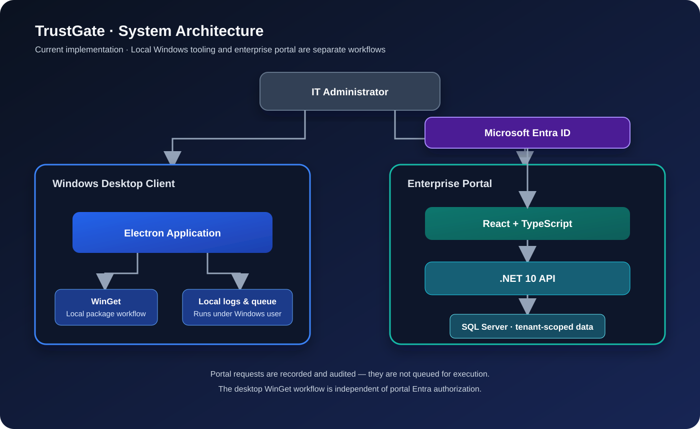
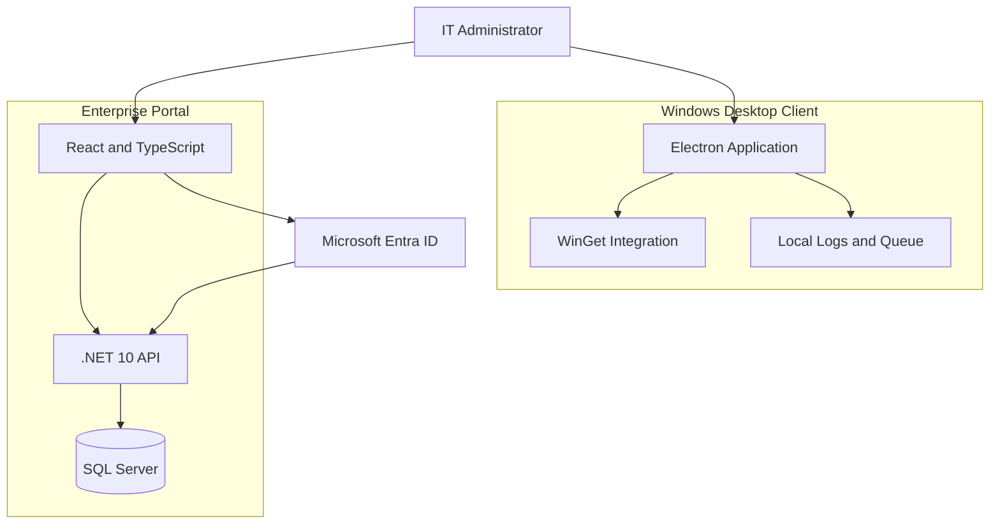

# TrustGate

## TrustGate Enterprise for Windows

The [Electron desktop client](./portal/desktop) runs local winget searches, version lookups, installs, upgrades, and uninstalls. Copy an exact package ID from the search results, optionally select a version, and approve the native confirmation to queue a change. Operations run one at a time under your Windows account and may request administrator approval. Winget requires Microsoft App Installer with its `winget.exe` app execution alias enabled. Closing the window keeps the queue running in the system tray; queue history resets on exit, while operation metadata remains in the rotating local log available in **Settings → Open logs**.

The .NET 10 API remains a separate service. Set `TRUSTGATE_PORTAL_URL` to the hosted portal's HTTPS URL before starting Electron. **Open enterprise portal** opens it in your default browser for Entra sign-in and tenant-scoped workflows. Local winget jobs are separate from tenant requests and are not controlled by Entra roles. Computer Rename is preview-only. Chocolatey, MSI/EXE execution, and the remaining Windows management modules are not implemented in this release.

On Windows x64 with Node.js 24:

```powershell
npm.cmd --prefix portal\web ci
npm.cmd --prefix portal\desktop ci
npm.cmd --prefix portal\desktop test
npm.cmd --prefix portal\desktop start
npm.cmd --prefix portal\desktop run package:win
```

The last command builds an NSIS installer and portable ZIP in `portal\desktop\dist`. Neither requires Node.js or .NET to run the desktop client. For a test build, run the installer or extract the entire ZIP and open **TrustGate Enterprise.exe**.

Test builds are unsigned, with updates disabled. To build for a managed release, configure Authenticode signing in electron-builder, set `TRUSTGATE_UPDATE_FEED` to your HTTPS generic feed, and set `TRUSTGATE_UPDATE_PUBLISHER` to the signing certificate's publisher name. The feed build requires signing. Publish the generated `latest.yml`, installer, and blockmap to that feed; users can check for updates and apply a downloaded update from Settings. The signed release path requires separate validation with your certificate and feed.

## Enterprise portal foundation

The [enterprise portal](./portal) is separate from the Windows desktop app. The React/TypeScript/Tailwind dashboard browses a tenant's device inventory and versioned software catalog, records requests, and shows recent history. A recorded request is **not queued or executed**. Intune, SCCM/MECM, AD, Graph, winget, Chocolatey, PowerShell, and the other enterprise execution modules are not connected in this portal.

### Identity and data requirements

- Use .NET 10 LTS, Node.js 24, and SQL Server. In each authorized Microsoft Entra tenant, provision the API and SPA app registrations or their enterprise applications. Configure the API for v2 access tokens, expose `api://<api-client-id>/Deployments.Access` as a delegated scope, and grant the SPA consent. Register the actual SPA **origin** as a SPA redirect URI. Assign users or groups the API app role `Deployment.Reader` or `Deployment.Operator`. Enforce MFA with Conditional Access in Entra; the portal does not implement its own MFA flow.
- Supply `Entra__ApiClientId`, `Entra__Tenants` (comma-separated authorized tenant GUIDs), and `ConnectionStrings__Sql` to the API. Supply `VITE_ENTRA_TENANT_ID`, `VITE_ENTRA_SPA_CLIENT_ID`, and `VITE_ENTRA_API_CLIENT_ID` to the web build. The API supports multiple allowlisted tenants; each SPA build signs into one of them. These IDs are not credentials. Keep database credentials out of Git and build arguments.
- Apply the [EF Core migrations](./portal/api/Migrations) using a separate migration identity. With `dotnet-ef` 10.0 installed, run `dotnet ef migrations script --idempotent --project portal/api` to generate SQL for review and deployment. Use [sample-data.sql](./portal/db/sample-data.sql) only against a development database, replacing the `TenantId` SQLCMD variable with your development tenant GUID. Inventory and catalog data are currently provisioned through SQL, not through an admin UI.
- Keys and foreign keys include the tenant ID. The API uses the verified token's tenant and actor rather than client-supplied identity. It writes the request and its audit event in one database save. Give the runtime database identity only required reads and inserts; reserve schema changes and catalog writes for separate identities. Protect audit retention and backups separately.

| API | Access |
| --- | --- |
| `GET /health/live` | Unauthenticated process liveness only |
| `GET /api/session`, `GET /api/devices`, `GET /api/catalog`, `GET /api/deployments` | Reader or Operator |
| `POST /api/deployments` (`deviceId`, `softwareId`) | Operator; records without executing |
| `GET /api/audit` | Operator; recent tenant audit events |

### Run and deploy

For development, start the API with `dotnet run --project portal/api -- --urls http://127.0.0.1:5080`; in `portal/web`, use `npm ci` then `npm run dev`. Register `http://localhost:5173` for local Entra testing and open that origin. Run `dotnet test portal/tests` and, from `portal/web`, `npm test` and `npm run build`.

The [Dockerfile](./portal/Dockerfile) serves the frontend and API on the same origin. Build from `portal` as the context, passing the three `VITE_ENTRA_*` values as `--build-arg` options. Supply the API variables at runtime. Before exposing the container on any network, place it behind an HTTPS ingress or reverse proxy, use SQL Server TLS with certificate validation, enable database/backup encryption at rest, and configure health monitoring. These controls are deployment requirements, not automatic guarantees of the image. Live Entra sign-in and SQL Server deployment must be verified in your environment. Redis, Electron, Kubernetes manifests, and Azure/on-prem production infrastructure are not part of this first slice.

## Employee Auto Login

The separate employee auto-login project is in [employee-auto-login](employee-auto-login/README.md). Its PowerShell scripts require Windows and PowerShell 5.1 or later; review its deployment and security documentation before use.

## TrustGate Setup

Install the runtime dependencies with `py -3 -m pip install -r requirements.txt`, then run `py -3 src/app.py`. To build a standalone Windows executable, run `powershell -ExecutionPolicy Bypass -File .\build.ps1`; the output is `dist\TrustGate.exe`. Copy this executable to a compatible Windows PC; it includes the Python runtime and the app's default configuration and printer template, so the source tree and Python are not required there. Windows Credential Manager must be available for secure credential features. Docker, WSL, and winget are optional separately installed integrations, not bundled dependencies.

Connection metadata is stored in `%LOCALAPPDATA%\TrustGate\settings.json`. API secrets, SSH private keys, and the per-install Ed25519 private identity key are stored in that Windows account's Credential Manager. Only the identity's public key is shown for registration with a platform. Profiles are saved locally; platform-specific network adapters must be implemented for the services you intend to use.

## Software Deployment

The Software Deployment page checks the configured Docker daemon, lists installed WSL distributions, and checks winget availability. Docker uses the current Docker context, which may point to a remote daemon. Select Windows Package Manager to install a package by its exact winget ID (for example, `Microsoft.PowerToys`); TrustGate asks for confirmation before running the installer from the configured `winget` source. The confirmation accepts package and source agreements. Installers may change the computer or request elevation, and should only be used with trusted package sources. These tools must already be installed and discoverable on `PATH`; TrustGate does not install them or deploy software through Docker or WSL.

## Dashboard and Plugin Marketplace

Select **Edit page** on the dashboard to add, remove, or reorder widgets using the dropdown. The **Plugin Marketplace** lists the built-in widgets and can add or remove them from the dashboard. Layouts are saved per Windows user in `%LOCALAPPDATA%\TrustGate\dashboard.json` (or `~/.local/share/TrustGate/dashboard.json` when `LOCALAPPDATA` is unavailable). The marketplace does not download or execute third-party plugins. These are local preferences, not department-wide layouts or administrator-enforced permissions; the other enterprise integrations and page-builder features in the plan are not yet implemented.

## Company Profile Manager

The Company Profiles page creates, edits, clones, and switches local profiles. The active profile is the default for AutoLogon and new deployment previews; switching does not apply changes to Windows or directory services. Local profiles and the active selection are stored in plaintext under `%LOCALAPPDATA%\TrustGate`; do not store passwords or other secrets in profiles.

Export and backup both save a single passphrase-encrypted `.tgprofile` file using scrypt and AES-256-GCM. Keep the passphrase safe: it is not saved and cannot be recovered. Import accepts these files or an unencrypted JSON object with `name` and `profile` fields. Existing profiles are never overwritten on import; choose another name when prompted. Exported files contain only profile configuration, not Credential Manager secrets. Microsoft Entra ID authentication and access control are not connected in this version.

## Deployment UI Preview

The dashboard includes a preview-only AutoLogon Manager, company presets, computer-name validation, a deployment wizard, and local JSON preview-report export. Generic presets are bundled from `config/company_profiles.default.json`. To use private company settings, place a JSON file in `%LOCALAPPDATA%\TrustGate\company_profiles.json`; it takes precedence over the bundled presets. When running from source, an untracked `config/company_profiles.json` is also supported if no per-user file exists. Neither private file is included in the executable. The preview workflow does not change Windows AutoLogon settings, join a domain, reset directory passwords, rename the computer, or deploy software, printers, or drives. The separate Software Deployment page can install Windows packages as described above. AutoLogon passwords are not saved or included in audit events or reports.


## System Architecture

The diagram below shows the current separation between the local Windows desktop client and the enterprise portal. The portal's Entra-protected API records tenant-scoped requests; it does not execute them. The desktop client's WinGet workflow runs locally and is separate from portal authorization.



<details>
<summary>View architecture source (Mermaid)</summary>



</details>

## Current implementation boundaries

TrustGate is an actively developed project with distinct local Windows tooling and an enterprise portal foundation. The current capabilities should be understood in these separate scopes:

| Area | Current status |
| --- | --- |
| Windows desktop software management | WinGet search, version lookup, install, upgrade, and uninstall workflows with confirmation and local operation logging |
| Enterprise portal | React/TypeScript interface with tenant-scoped device/catalog views and request history |
| Portal deployment requests | Requests are recorded and audited; they are **not** sent to an execution queue and do not install software |
| Microsoft Entra ID | Authentication and tenant authorization are part of the portal architecture and require environment-specific app registration and configuration before use |
| Intune, SCCM/MECM, Active Directory, Microsoft Graph, Chocolatey, and centralized PowerShell execution | Listed as future integration areas; not connected as portal execution backends in this release |
| Computer rename, domain join, AutoLogon, and other provisioning previews | Preview and validation workflows only; they do not apply those system changes |

The desktop WinGet workflow is separate from the portal's Entra-protected request workflow. A successful local package installation does not imply that a portal request was executed, and a portal request record does not trigger a local installation.


## Screenshots

The optimized screenshot files are prepared locally, but the image assets have not yet been uploaded to this repository. The gallery will appear here after those binary files are committed under `docs/images/`.

